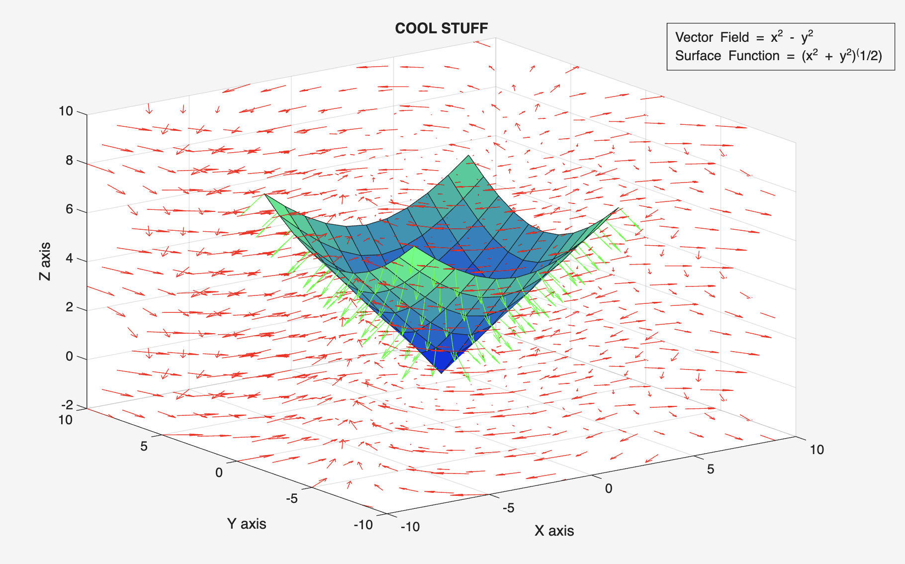

# Multivariable Calculus Vector Field Visualizations

**Domain:** Multivariable Calculus (Calc 3) | 3D Scientific Visualization | Symbolic Computation  
**Tools & Frameworks:** MATLAB, Symbolic Math Toolbox (`syms`, `diff`, `matlabFunction`), 3D Quiver & Surface Plotting

> **Project Inspiration & Dedication:** This project is dedicated to my incredible Math Professor **Gabriel Pretel (Gabe)** and Computer Science Professor **Stephen Strenn**. While taking Calculus 3, visualizing 3D vector fields, surfaces, and outward/inward normal vectors on a 2D whiteboard or paper was challenging. I built this script as an interactive learning aid to bring Calc 3 flux and surface integrals to life in 3D space—combining the multivariable calculus concepts taught by Gabe with the programming foundation I learned from Prof. Strenn.

### Project Source File
* [📥 Download `CoolSTUFF.m` (MATLAB Visualization Script)](https://github.com/evanjameswarren/evanjameswarren.github.io/raw/main/Calc%203%20Visuals/CoolSTUFF.m)

---

## 1. Overview & Learning Objective
In Multivariable Calculus, evaluating flux across a 3D surface ($\iint_S \mathbf{F} \cdot \mathbf{n} \, dS$) requires understanding how a vector field $\mathbf{F}(x,y,z)$ interacts with a surface $z = f(x,y)$ and its unit normal orientation $\mathbf{n}$.

This MATLAB script serves as a plug-and-play visual aid where any symbolic surface and vector field can be entered at the top of the script to immediately see:
* **The 3D Surface ($z = \sqrt{x^2 + y^2}$):** Rendered with a `winter` colormap mesh.
* **The 3D Vector Field ($\mathbf{F} = \langle x^2 - y^2, xy - 4, 0 \rangle$):** Plotted across the 3D coordinate space using red directional vectors (`quiver3`).
* **Surface Normal Vectors ($\mathbf{n} = \pm \langle -f_x, -f_y, 1 \rangle$):** Automatically differentiated using symbolic calculus and plotted in green directly on the surface, with a simple `normSwitch` (`1` or `0`) to toggle between upward and downward normal orientations.

---

## 2. 3D Visualization Output



---

## 3. MATLAB Code (`CoolSTUFF.m`)

```matlab
% Adjustment section
normSwitch = 0; % normal up (1), normal down (0)

syms x y z
symsSurface = sqrt(x^2 + y^2);
symsField = [x^2-y^2, x*y-4, 0];
surfNorm = [-diff(symsSurface,x), -diff(symsSurface,y), 1];

if normSwitch
    n = 1;
else 
    n = -1;
end

% Symbolic to Numerical Function Handles
[surfX,surfY] = meshgrid(-5:5);
surface = matlabFunction(symsSurface);
surface = surface(surfX,surfY);

P = matlabFunction(symsField(1),"Vars",{x,y,z});
Q = matlabFunction(symsField(2),"Vars",{x,y,z});
normX = matlabFunction(surfNorm(1),"Vars",{x,y});
normY = matlabFunction(surfNorm(2),"Vars",{x,y});

% 3D Surface, Vector Field (Red), and Normal Vectors (Green)
surf(surfX,surfY,surface);
colormap("winter")
quiver3(vectorX,vectorY,vectorZ,scaler*P,scaler*Q,scaler*R,2,"Color","red")
quiver3(surfX,surfY,surface,n.*normX(surfX,surfY),n.*normY(surfX,surfY),(n).*ones(size(surface)),"Color","green")
```

---

[← Back to Main Portfolio](../index.html)
