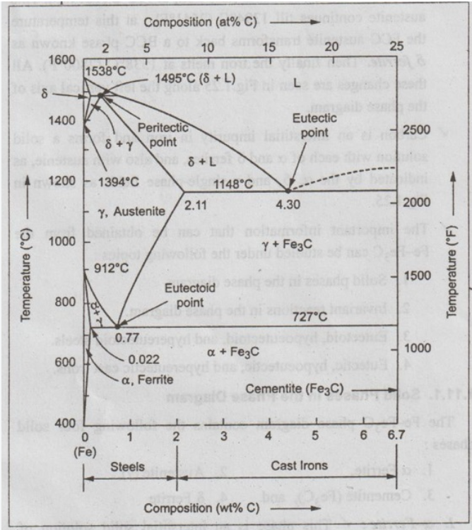
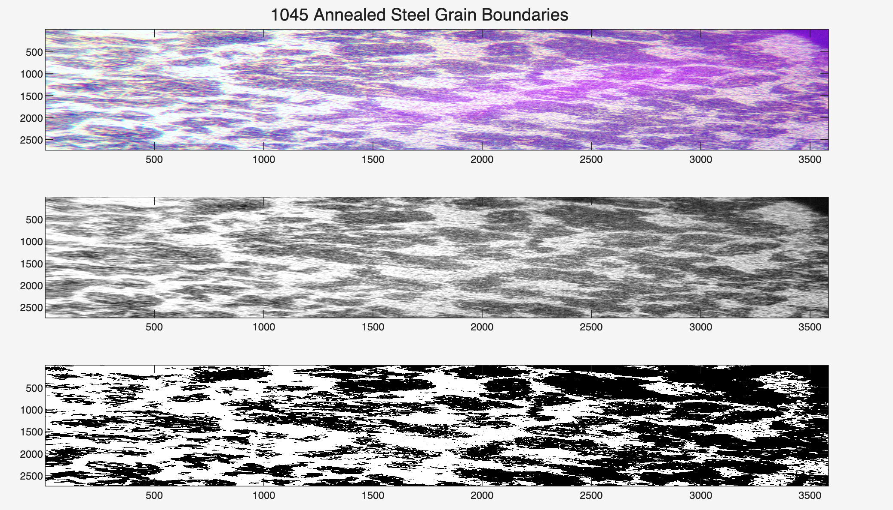
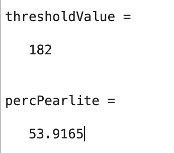

# 1045 Annealed Steel Microstructure & Phase Analysis

**Course:** Engineering Materials Lab  
**Domain:** Metallography | Image Processing | Phase Diagram Analysis  
**Tools:** MATLAB (`rgb2gray`, Otsu Thresholding), Optical Microscopy (40x)

> **Project Overview:** Completed for an **Engineering Materials** course lab, this project analyzes a 40x optical micrograph of **AISI 1045 annealed steel** ($0.45\text{ wt\% C}$) taken after polishing and a 3rd chemical etch. Using MATLAB image processing and Otsu's thresholding method (`thresholdValue = 182`), the script isolates the bright **proeutectoid ferrite ($\alpha$)** grain boundaries from the dark **pearlite** colonies and compares the measured pearlite phase fraction (**`53.92%`**) against the theoretical **`57.22%`** predicted by the $\text{Fe–Fe}_3\text{C}$ phase diagram.

### Project Source Files
* [📥 Download `lab10.m` (MATLAB Image Processing Script)](https://github.com/evanjameswarren/evanjameswarren.github.io/raw/main/Grain%20Boundries/lab10.m)
* [📥 Download `1045_post_3rd_etch_40x.jpg` (Raw 40x Etched Micrograph)](https://github.com/evanjameswarren/evanjameswarren.github.io/raw/main/Grain%20Boundries/1045_post_3rd_etch_40x.jpg)

---

## 1. Theoretical Phase Fraction ($\text{Fe–Fe}_3\text{C}$ Lever Rule)

For hypoeutectoid **1045 steel** ($C_0 = 0.45\text{ wt\% C}$) slowly cooled (annealed) through the $727^\circ\text{C}$ eutectoid temperature, the expected fraction of **Pearlite** versus **Proeutectoid Ferrite ($\alpha$)** is given by the Lever Rule between $C_\alpha = 0.022\text{ wt\% C}$ and $C_{\text{eutectoid}} = 0.77\text{ wt\% C}$:

$$\%\text{Pearlite}_{\text{expected}} = \frac{0.45 - 0.022}{0.77 - 0.022} \times 100 = \mathbf{57.22\%}$$



---

## 2. MATLAB Image Processing & Thresholding Results

The raw 3D RGB micrograph is converted into a 2D grayscale intensity matrix (`0` to `255`) using `rgb2gray`. Applying an objective Otsu threshold (`thresholdValue = 182`) separates the dark pearlite regions (`0`, black) from the reflective proeutectoid ferrite grain boundaries (`1`, white):



### Measured vs. Theoretical Comparison

| Metric | Value | Notes |
| :--- | :---: | :--- |
| **Otsu Threshold (`thresholdValue`)** | **`182`** | Intensity cutoff (`0–255` grayscale scale) |
| **Measured Pearlite (`percPearlite`)** | **`53.92%`** | Percentage of pixels below threshold (`182`) |
| **Expected Pearlite (Lever Rule)** | **`57.22%`** | Theoretical $\text{Fe–Fe}_3\text{C}$ equilibrium value at $0.45\text{ wt\% C}$ |
| **Absolute Difference** | **`3.30%`** | Minor offset caused by bright lens glare on the left edge |



### MATLAB Implementation (`lab10.m`)

```matlab
clear; close all;

img = imread("1045_post_3rd_etch_40x.jpg"); 
subplot(3,1,1)
sgtitle("1045 Annealed Steel Grain Boundaries")
imagesc(img)
imgGray = rgb2gray(img); % converting img from 3dim(rgb), to single value for easier manipulation
[h,w] = size(imgGray); 
colormap("gray")
subplot(3,1,2)
imagesc(imgGray)
hold on 

thresholdValue = 255 * graythresh(imgGray) % graythresh() function to identify image pixel threshold value
imgLogical = imgGray > thresholdValue;
subplot(3,1,3)
imagesc(imgLogical)

pearlitePix = nnz(imgLogical);
totalPix = h * w;
percPearlite = 100 * (1 - (pearlitePix / totalPix))
```

---

[← Back to Main Portfolio](../index.html)
