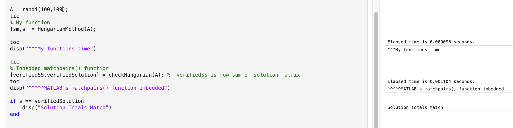
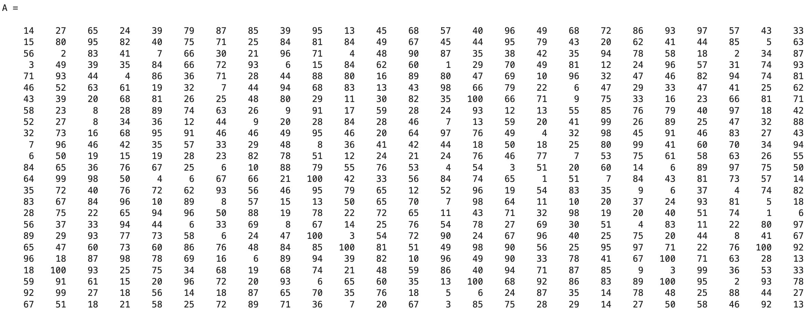
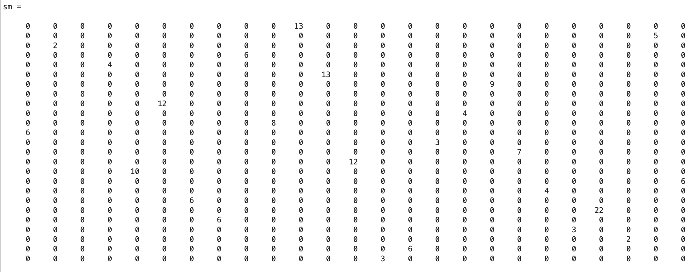

# Hungarian Method Optimization Algorithm

**Domain:** Operations Research | Combinatorial Optimization | Algorithm Design  
**Tools & Frameworks:** MATLAB, Logical Matrix Masking, Binary Bit-Flipping Logic, Bipartite Matching

> **Project Inspiration:** I was first inspired to take on this project while taking Operations Research at CSUEB with Prof. Hernández-Negrón. After first learning to solve assignment problems by hand, I wanted to write a quick script to check my homework—and quickly discovered that the Hungarian Method is **not** an easy algorithm to program from scratch. Determined to make it work, I applied binary bit-flipping concepts I had learned in an Assembly language course to manipulate logical matrix masks in MATLAB. Over the next year, I spent **50+ hours** iteratively breaking, debugging, and refining the logic to scale up the matrix sizes it could handle. While it remains a work in progress for edge-case crashes on very specific tie scenarios in large $100 \times 100$ matrices, it solves $100 \times 100$ problems in **`0.0091 seconds`** and is a project I am extremely proud of.

### Project Source Files & Scripts
* [📥 `HungarianMethod.m` (Main Driver Function)](https://github.com/evanjameswarren/evanjameswarren.github.io/raw/main/Hungarian/HungarianMethod.m)
* [📥 `Reduced_Mask.m` (Row & Column Reduction)](https://github.com/evanjameswarren/evanjameswarren.github.io/raw/main/Hungarian/Reduced_Mask.m)
* [📥 `Assignment_Iteration.m` (Logical Scanning & Tie-Breaker Engine)](https://github.com/evanjameswarren/evanjameswarren.github.io/raw/main/Hungarian/Assignment_Iteration.m)
* [📥 `Matrix_Adjustment.m` (Line Covering & $\theta$-Adjustment)](https://github.com/evanjameswarren/evanjameswarren.github.io/raw/main/Hungarian/Matrix_Adjustment.m)
* [📥 `TimeCheck.mlx` (Benchmark Validation Live Script)](https://github.com/evanjameswarren/evanjameswarren.github.io/raw/main/Hungarian/TimeCheck.mlx)
* [📥 `checkHungarian.m` (Reference `matchpairs()` Validation Wrapper*)](https://github.com/evanjameswarren/evanjameswarren.github.io/raw/main/Hungarian/checkHungarian.m)

---

## 1. Problem Statement
The classic **Assignment Problem** requires matching $n$ resources/agents to $n$ tasks on a one-to-one basis to minimize total operational cost:

$$\min \sum_{i=1}^{n} \sum_{j=1}^{n} c_{ij} x_{ij} \quad \text{subject to} \quad \sum_{j=1}^{n} x_{ij} = 1, \quad \sum_{i=1}^{n} x_{ij} = 1, \quad x_{ij} \in \{0,1\}$$

While small $4 \times 4$ homework matrices can be solved by hand, scaling up to $40 \times 40$ or $100 \times 100$ matrices requires automated algorithmic logic capable of isolating zero-cost assignments, resolving multi-zero ties, and performing minimum line-covering matrix adjustments.

---

## 2. Modular Architecture & Bit-Flipping Logic

Drawing from Assembly-style binary bit masking (`&`, `|`, `~`), the solver avoids slow scalar loops and instead operates directly on logical `1`/`0` bitmasks across four modular MATLAB functions:

### Stage 1: Main Solver Loop (`HungarianMethod.m`)
Orchestrates initial cost reduction and iteratively alternates between zero-assignment scanning and $\theta$-matrix adjustments until the number of independent assignments (`nnz(solutionMask)`) equals the matrix dimension $l$.

```matlab
function [solutionMatrix,solutionTotal] = HungarianMethod(squareMatrix)
A = squareMatrix;
l = size(A,1);
reducedA = Reduced_Mask(A); % Initial row/col reduction

solutionFound = false;
while ~solutionFound
    mask = reducedA == 0; % Convert reduced matrix to logical zero-mask
    solutionMask = Assignment_Iteration(mask); % Assign & tie-break
    if nnz(solutionMask) == l
        solutionFound = true;
        break
    else
        reducedA = Matrix_Adjustment(reducedA,solutionMask); % Theta adjustment
    end
end
solutionMatrix = solutionMask .* A;
solutionTotal = sum(sum(solutionMatrix));
end
```

### Stage 2: Row & Column Reduction (`Reduced_Mask.m`)
Subtracts the minimum value of each row and column to establish initial zero locations:

```matlab
function [reducedA] = Reduced_Mask(A)
reducedA = A - min(A,[],2);        % Subtract row minima
reducedA = reducedA - min(reducedA,[],1); % Subtract column minima
end
```

### Stage 3: Iterative Assignment & Tie-Breaker (`Assignment_Iteration.m`)
Scans rows and columns for single isolated zeros (`sum(iteration) == 1`), locking in assignments and flipping bits (`& ~iteration`) to mask out assigned rows and columns.

**The Tie-Breaker Mechanism:** When multiple zeros create a stalemate where no single-zero rows or columns remain, the script triggers a custom tie-breaker—sorting unassigned rows by the fewest remaining zeros and locking in the first available open column before returning to the main scan loop:

```matlab
elseif ~newAssignment % TIE BREAKERS!!!! <<<<< HARDEST PART
    unassignedRows = find(~assignedRows);
    [~,sortedIndex] = sort(sum(iterationMask(unassignedRows,:),2));
    unassignedRows = unassignedRows(sortedIndex)';
    for i = unassignedRows
        openColumn = find(iterationMask(i,:) & ~assignedCols);
        if ~isempty(openColumn)
            assignedCols(openColumn(1)) = true;
            assignedRows(i) = true;
            iterationMask = (iterationMask & ~assignedCols) & ~assignedRows;
            solutionMask(i,openColumn(1)) = true;
            newAssignment = true;
            break
        end
    end
```

### Stage 4: Minimum Line Covering & $\theta$-Adjustment (`Matrix_Adjustment.m`)
When fewer than $l$ assignments can be made, the function determines the minimum covering lines using iterative logical highlighting. It then finds the smallest uncovered value ($\theta$), subtracts $\theta$ from uncovered elements, and adds $\theta$ to double-covered intersections to create new zero candidates:

```matlab
thetaSubMask = (highLightMask & ~dashRows) & ~dashCols; % Uncovered elements
thetaCopy = copy .* thetaSubMask;
theta = min(min(thetaCopy(thetaCopy > 0)));             % Minimum uncovered value
thetaAddMask = highLightMask & dashRows;                % Double-covered intersections
new_copy = copy - thetaSubMask.*theta + thetaAddMask.*theta;
```

---

## 3. Visual Validation & Runtime Benchmarking

### $100 \times 100$ Clock-Time Benchmark vs. MATLAB `matchpairs()`
Tested on a randomized $100 \times 100$ cost matrix (`randi(100,100)`), the custom `HungarianMethod()` script finishes in **`0.009098 seconds` (~9.1 ms)** and matches the exact minimum cost verified by `checkHungarian.m` (which wraps MATLAB's built-in `matchpairs()` solver).



### Visualized Matrix Transformation: Input Cost Matrix vs. Optimal Sparse Solution
Below is a randomized cost matrix ($A$) alongside the resulting sparse optimal assignment matrix ($sm = \text{solutionMask} \odot A$), isolating the exact minimum-cost pairings:

#### Unsolved Random Cost Matrix ($A$)


#### Solved Optimal Assignment Matrix ($sm$)


---

## 4. Key Takeaways & Performance Summary

| Performance Dimension | Metric / Outcome | Notes |
| :--- | :---: | :--- |
| **$100 \times 100$ Execution Time** | **`0.0091 seconds`** | Powered by logical bitmask indexing (`&`, `|`, `~`) |
| **Optimality Verification** | **100% Cost Match** | Verified against MATLAB's built-in `matchpairs()` function |
| **Current Scope & Work in Progress** | **~50% on $100 \times 100$** | Edge-case multi-zero tie scenarios in large $100 \times 100$ matrices are an ongoing area of refinement |

---

> ***Disclaimer & Code Attribution:** All core Hungarian Method logic (`HungarianMethod.m`, `Reduced_Mask.m`, `Assignment_Iteration.m`, and `Matrix_Adjustment.m`) was written 100% by hand from scratch. The validation wrapper script [`checkHungarian.m`](https://github.com/evanjameswarren/evanjameswarren.github.io/raw/main/Hungarian/checkHungarian.m), which embeds MATLAB's built-in `matchpairs()` function to verify solution totals, was the only AI-generated script in this project.*

---

[← Back to Main Portfolio](../index.html)
