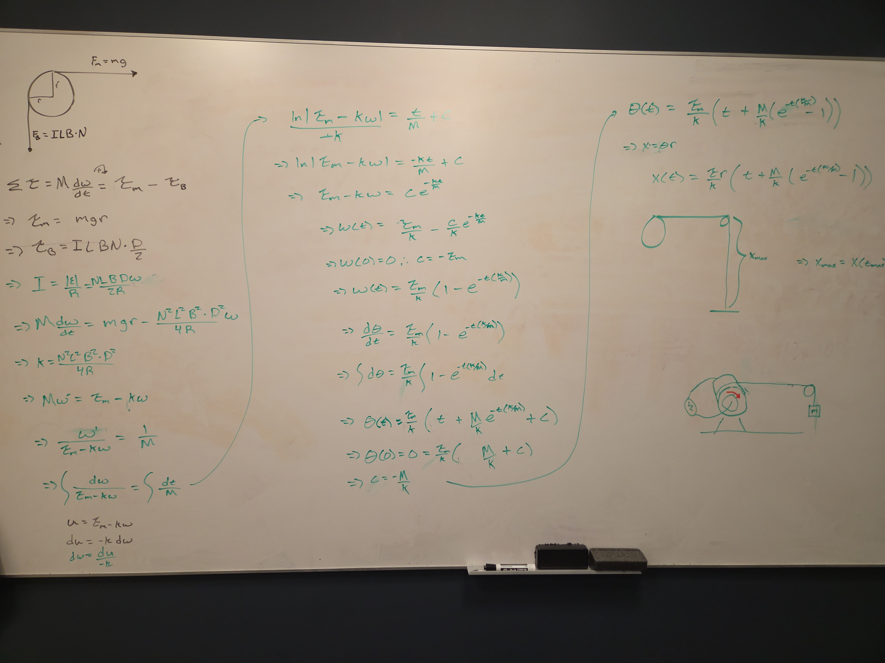
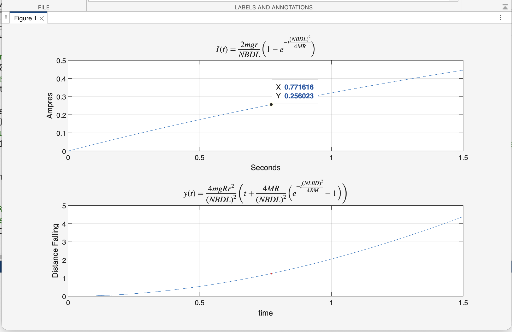
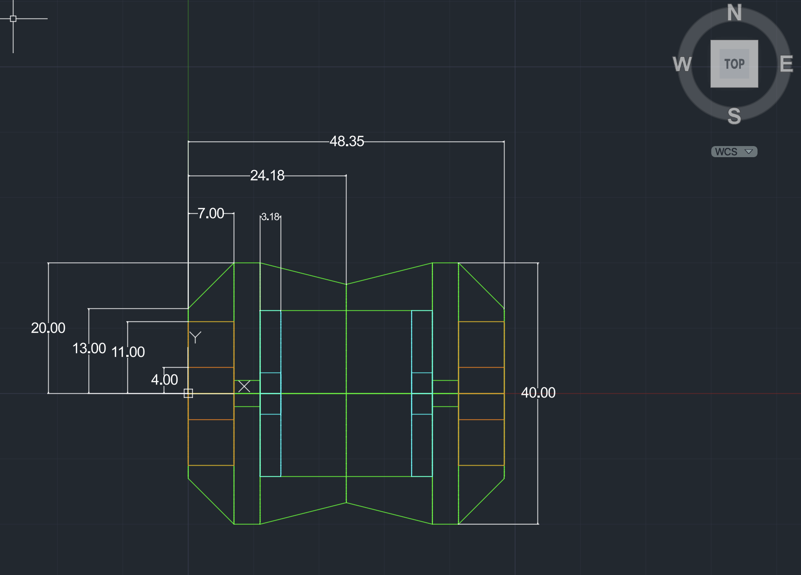
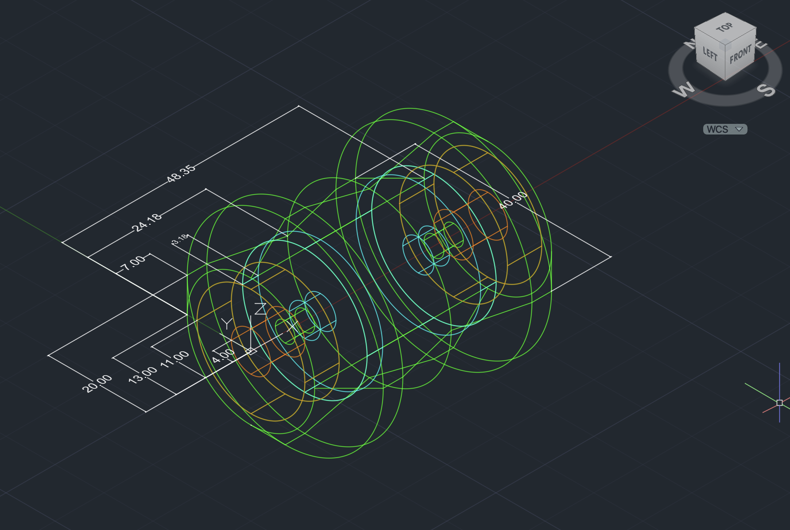
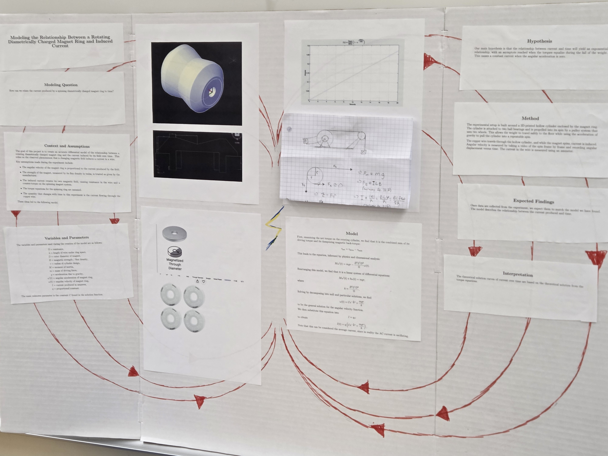

# **[IN PROGRESS]** Mini-Alternator Differential Dynamic System & Electromechanical Modeling

**Course:** Differential Systems / Mechatronics  
**Domain:** Differential Systems & Mechatronics | Analytical Dynamics | CAD / Prototyping  
**Tools & Software:** MATLAB, AutoCAD (3D Revolve & Parametric Drafting), First-Order Differential Equations, 3D Printing  
**Project Partner:** Julian Muñoz  
**Status:** **[IN PROGRESS]** (Analytical Modeling, MATLAB Dynamics & AutoCAD Design Complete; Rotor Joint Modeling & 3D Fabrication Underway)

> **Project Overview & Objectives:** The assignment for this project was to mathematically model a physical differential system. Project partner Julian and I chose to mathematically model an induced electrical current over time. Through understanding basic principles in dynamics and electromagnetism, we decided to design a cylindrical device with embedded diametrically polarized magnets, driven by a small falling mass from a lab countertop. We mathematically solve for the current and solve for the time of mass impact with the ground, then design the physical specs of the project attempting to achieve the greatest amount of peak current convergence to avoid a pure linear system. Once the physical experiment is built and data is collected, we will compare our experimental readings to the mathematical model.

### Project Source Files & Models
* [📥 Download `InducedCurrent.m` (MATLAB Dynamic Simulation & Kinematics Script)](https://github.com/evanjameswarren/evanjameswarren.github.io/raw/main/Induced%20Current/InducedCurrent.m)
* [📥 Download `CylinderModel 3D.dwg` (AutoCAD 3D Rotor & Spool Model)](https://github.com/evanjameswarren/evanjameswarren.github.io/raw/main/Induced%20Current/CylinderModel%203D.dwg)

---

## 1. Governing Physics & Analytical Whiteboard Derivations

The dynamic system couples mechanical rotational acceleration with Faraday's Law of Induction and Lorentz magnetic counter-torque.



### A. Rotational Newton's 2nd Law
Summing torques on the rotor with moment of inertia $M$, drive spool radius $r$, and driving mass $m$:

$$\sum \tau = M \frac{d\omega}{dt} = \tau_{\text{drive}} - \tau_{\text{braking}}$$

$$\tau_{\text{drive}} = m g r$$

$$\tau_{\text{braking}} = F_{\text{Lorentz}} \cdot \frac{D_{\text{eff}}}{2} = (I L B N) \cdot \frac{D_{\text{eff}}}{2}$$

### B. Induced Current & Back-Torque Constant ($k$)
The electromotive force (EMF) generated across $N$ wire loops cut by magnetic flux density $B$ over active conductor length $L$ and linear velocity $v = \omega \cdot \frac{D_{\text{eff}}}{2}$ is:

$$\mathcal{E} = N B L v = N B L \left(\omega \frac{D_{\text{eff}}}{2}\right)$$

$$I(t) = \frac{\mathcal{E}}{R} = \frac{N B L D_{\text{eff}}}{2R} \omega(t)$$

Substituting back into the torque balance gives a 1st-order linear ODE:

$$M \frac{d\omega}{dt} = m g r - \left(\frac{N^2 B^2 L^2 D_{\text{eff}}^2}{4R}\right)\omega$$

Defining the electromagnetic damping constant $k = \frac{(N B D_{\text{eff}} L)^2}{4R}$ and drive torque $\tau_m = m g r$:

$$M \frac{d\omega}{dt} + k \omega = \tau_m$$

### C. Analytical Solutions for $\omega(t)$, $I(t)$, and Fall Kinematics $y(t)$
Solving via separation of variables with initial condition $\omega(0) = 0$:

$$\omega(t) = \frac{\tau_m}{k} \left(1 - e^{-\frac{k}{M}t}\right)$$

$$I(t) = \left(\frac{2 m g r}{N B D_{\text{eff}} L}\right) \left(1 - e^{-t \frac{(N B D_{\text{eff}} L)^2}{4 M R}}\right)$$

Integrating $\omega(t) = \frac{d\theta}{dt}$ to find total angular displacement $\theta(t)$ and multiplying by spool radius $r$ gives the exact vertical drop trajectory $y(t)$:

$$y(t) = r \theta(t) = \frac{4 m g R r^2}{(N B D_{\text{eff}} L)^2} \left[ t + \frac{4 M R}{(N B D_{\text{eff}} L)^2} \left(e^{-t \frac{(N B D_{\text{eff}} L)^2}{4 M R}} - 1\right) \right]$$

---

## 2. MATLAB Dynamic Simulation & Ground Impact Tracking

The analytical expressions were modeled in [`InducedCurrent.m`](https://github.com/evanjameswarren/evanjameswarren.github.io/raw/main/Induced%20Current/InducedCurrent.m). Using symbolic algebra (`syms tmax positive`), the script solves for the exact duration of the drop until ground contact ($h = 1.0\text{ m}$), plotting current ramp-up and vertical displacement:



### Key Simulated Parameters & Results

| Parameter / Variable | Symbol | Value | Unit / Description |
| :--- | :---: | :---: | :--- |
| **Driving Mass** | $m$ | **`0.005`** | $\text{kg}$ ($5\text{ g}$ tabletop drop weight) |
| **Spool Radius** | $r$ | **`16.7`** | $\text{mm}$ ($0.0167\text{ m}$) |
| **Table Drop Height** | $h$ | **`1.0`** | $\text{m}$ |
| **Magnet Flux Density** | $B$ | **`0.7`** | $\text{T}$ (Neodymium NdFeB diametrical stack) |
| **Effective Diameter** | $D_{\text{eff}}$ | **`15.875`** | $\text{mm}$ ($\frac{D_{\text{in}} + D_{\text{out}}}{2} = 0.625"$) |
| **Stator Coil Windings** | $N$ | **`20`** | Loops of AWG 24 enameled copper magnet wire |
| **Coil Resistance** | $R$ | **`0.513`** | $\Omega$ |
| **Ground Impact Time** | $t_{\text{max}}$ | **`0.7716`** | $\text{s}$ (Elapsed time to $y = 1.0\text{ m}$) |
| **Current at Impact** | $I(t_{\text{max}})$ | **`0.256`** | $\text{A}$ ($256\text{ mA}$) |

### MATLAB Dynamic Code (`InducedCurrent.m`)

```matlab
clear;clc;clf;

t = linspace(0,3,10000);


meters = 0.0254; % meters per inch conversion

m = .005; % driving force mass kg


id = 1/4; % Magnet inner diameter in inches
od= 1; % magnet outer diameter in inches
Deff = (id+od)*.5; % effective magnetic torque diameter

g = 9.8; % Gravity (meters/s^2)
r = 16.7/1000; % Radius of cylinder design in (meters)
B = 0.7; % magnetic flux density of magnets (Teslas) 
L = .5 * meters; % depth of magnets (meters) (3 inches)

D = Deff*meters; % effective magnetic torque diameter (meters)
M = 3*10^(-6); % moment of inertia of cylinder design (kg/meters^2) *** this is an estimate ** 
N = 20; %  number of wire loops
R = 0.02567*1*N; % resistence in (ohms) of wire 1 ft wire AWG 24 magnet wire * 1.5 per loop * (N) number of loops 


I = @(t) (2*m*g*r/(N*B*D*L))*(1-exp(-t*((N*B*D*L)^2)/(M*R*4)));


Tm = m*g*r; % drive torque
h = 1; % estimated table height
k = ((N*L*B*D)^2)/(4*R); %simplifying constant


y = @(t) (r*Tm/k)*(t+(M/k)*(exp(-t*(k/M))-1)); % fall distance

syms tmax positive
t_max = double(solve(y(tmax)==h,tmax)); % Solving for max time when driving mass hits the ground

subplot(2,1,1)
plot(t,I(t))

xlabel("Seconds")
ylabel("Ampres")
title('$$I(t) = \frac{2mgr}{NBDL}\left(1 - e^{-t\frac{(NBDL)^2}{4MR}}\right)$$', 'Interpreter', 'latex', 'FontSize', 12);
grid on
hold on
plot(t_max,I(t_max),".r")
hold off
k = ((N*L*B*D)^2)/(4*R); %simplifying constant
y = @(t) (r*Tm/k)*(t+(M/k)*(exp(-t*(k/M))-1)); % fall distance

subplot(2,1,2)
plot(t,y(t))

title('$$y(t) = \frac{4mgRr^2}{(NBDL)^2}\left(t + \frac{4MR}{(NBDL)^2}\left(e^{-t\frac{(NLBD)^2}{4RM}} - 1\right)\right)$$', 'Interpreter', 'latex', 'FontSize', 12)
hold on
xlabel("time")
ylabel("Distance Falling")
grid on
plot(t_max,y(t_max),".r")
hold off
```

---

## 3. CAD Hardware Engineering & Rotor Architecture (AutoCAD)

To house the diametrical ring magnets and ceramic bearings while allowing the pull-string to coil smoothly without slipping, a custom rotor was designed and modeled in AutoCAD (`CylinderModel 3D.dwg`):





### Mechanical Design Constraints & Features:
* **Non-Magnetic Ceramic Bearings:** Designed with twin press-fit pockets for **608CE Full Ceramic ($\text{ZrO}_2$)** bearings ($\varnothing 22\text{ mm} \times 7\text{ mm}$ width, $8\text{ mm}$ bore). Using non-metallic ceramic bearings eliminates parasitic magnetic cogging/eddy-current drag against the permanent magnets.
* **Internal Magnet Cavity:** Sized at $\varnothing 25.4\text{ mm}$ ($1.0"$) outer diameter and $12.7\text{ mm}$ ($0.5"$) stack depth to securely clamp the NdFeB diametrically magnetized ring magnets.
* **Central Stator Bore:** A central $4\text{ mm}$ radius ($8\text{ mm}$ bore) wire cavity allows the stationary AWG 24 copper stator core to pass directly through the axis of rotation.
* **Hourglass Tether Spool Waist:** The exterior features a tapered profile terminating at a spool waist radius $r = 16.7\text{ mm}$ ($48.35\text{ mm}$ total width) to naturally center and guide the unwinding drive string.

---

## 4. Current Progress & Next Steps



* [x] **Mathematical Modeling:** First-principles Newtonian & Faraday ODE derivation complete.
* [x] **Simulation:** MATLAB analytical solution and ground-impact solving verified.
* [x] **CAD Architecture:** 2D cross-section and full 3D solid revolution completed.
* [ ] **Tolerance Assurance & 3D Print Fits:** Verifying shrink/clearance tolerances for bearing and magnet press-fits.
* [ ] **Split-Joint Lip Modeling:** Converting the monolithic rotor cross-section into two interlocking printable halves with a stepped alignment lip at $X = 24.18\text{ mm}$.
* [ ] **AutoCAD Rig & Fixture Design:** Designing the support stands for the cylinder and the pulley wheel / upright stands for the falling mass guide line.
* [ ] **Additive Manufacturing:** 3D printing all rotor halves and test stand components in high-infill PLA/PETG.
* [ ] **Perform Experiment:** Collecting real physical data during mass drops and reading induced current with an oscilloscope to compare against the mathematical model.

---

> **AI Disclosure:** All physics derivations, mathematical modeling, CAD drawings, and MATLAB code were independently developed by the project team. Generative AI was used strictly for formatting LaTeX equation syntax in Markdown for web display.

---

[← Back to Main Portfolio](../index.html)
