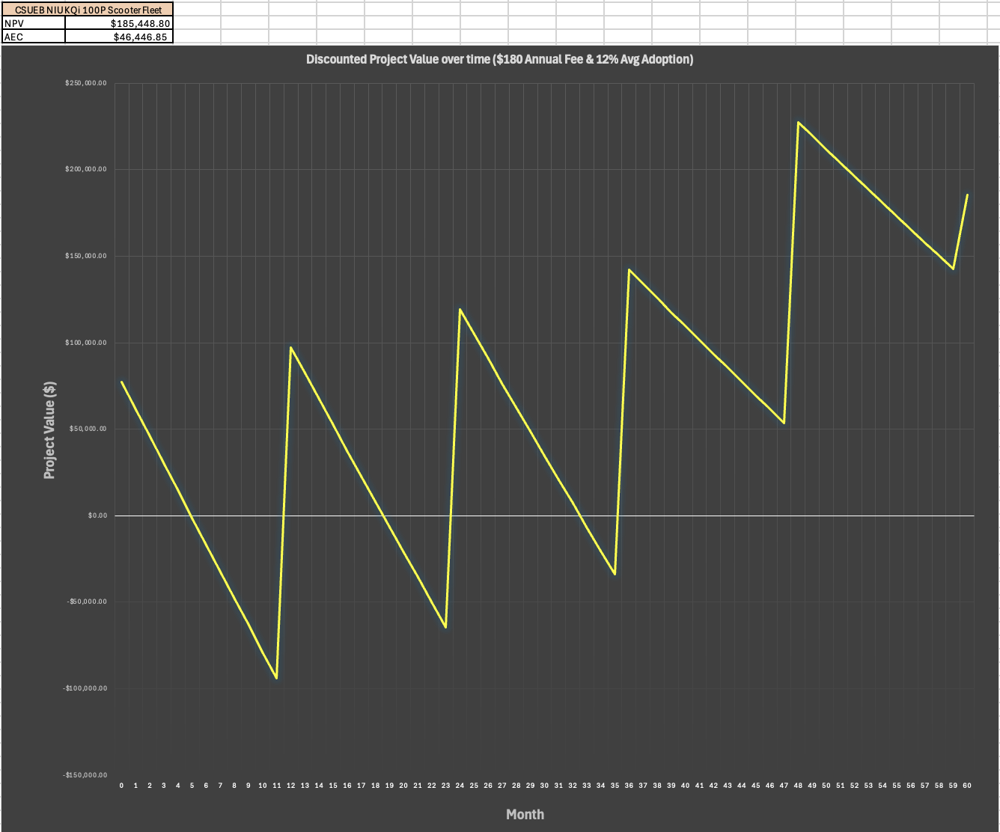
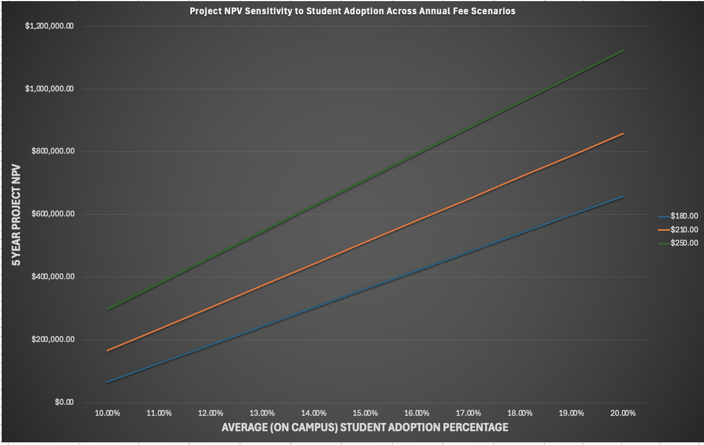
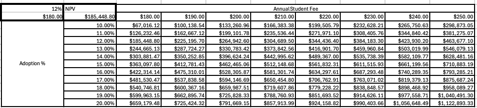

# CSUEB Electric Scooter Fleet Rollout

**Domain:** Systems Logistics | Financial Engineering | IoT Infrastructure | Regulatory Compliance  
**Tools & Frameworks:** Operations Research, Engineering Economics (NPV/AEC/MARR), Systems Engineering (Type A/B/C Specs), Joyride IoT, Kuhmute Smart Hubs

> **Executive Impact & Project Summary:** Conducted an end-to-end Systems Design and Economic Feasibility study for a 130-vehicle electric scooter micro-mobility rollout at Cal State East Bay (2026–2031). Under a baseline 12% student adoption rate (864 opt-in users), the project achieves a verified **$185,449 Net Present Value (NPV)** and **$46,447 Annual Equivalent Worth (AEC)** over a 5-year operational lifecycle. Revenue is driven by a hybrid pricing structure combining a **$180.00 annual membership fee** with a **$0.50/mile usage fee**, generating $217k–$258k in annual gross receipts. The model is supported by a 60-month discounted cash flow schedule, comprehensive Type A/B/C engineering specifications, and a 2D sensitivity matrix validating resilience from **$67k to $1.12M NPV**.

### Project Resources & Supporting Documents
* [📥 Download Original Financial & Cash Flow Model (.xlsx)](https://github.com/evanjameswarren/evanjameswarren.github.io/raw/main/Electic%20Scooter%20Fleet/INDE%20460%20-%20Cost%20Final%20Project.xlsx)
* [📥 Download Complete Systems Engineering Specification (.docx)](https://github.com/evanjameswarren/evanjameswarren.github.io/raw/main/Electic%20Scooter%20Fleet/CSUEB%20Electric%20Scooter%20Rollout.docx)

---

## 1. Problem Definition & Campus Context
Cal State East Bay (CSUEB) is a hillside commuter campus where students navigate severe elevation shifts, time-constrained class transitions, and peripheral parking lots. Walking between distant lots and academic buildings causes transit friction, class tardiness, and physical fatigue.

This project delivers a localized micro-mobility ecosystem providing rapid, on-demand campus transit while maintaining strict safety, ADA path compliance, and rigorous financial sustainability.

---

## 2. Multidisciplinary Systems Engineering Considerations

### A. Financial Engineering & Economic Modeling
* **60-Month Discounted Cash Flow:** Formulated a complete monthly schedule evaluating feasibility against the Minimum Acceptable Rate of Return (MARR) across loan annuity structures (5%–7% nominal interest with 25% down payment).
* **Baseline Feasibility:** Evaluated the optimal baseline scenario ($180 annual fee + $0.50/mile) yielding a **$185,449 5-Year NPV** and **$46,447 Annual Equivalent Worth (AEC)**.
* **Inflation Factor Modeling:** Applied compounding annual inflation factors (3.5% baseline) to labor, replacement components, utility rates, and software licensing.
* **2D Sensitivity Analysis:** Built a comprehensive sensitivity matrix spanning 10%–20% student adoption and $180–$250 annual fee tiers, proving positive economic returns across all scenarios ($67k to $1.12M).

### B. Revenue Architecture: Hybrid Fee Model
* **Annual Opt-In Membership ($180.00/yr):** Modeled on 12,000 enrolled students with 60% on-campus presence (7,200 students). A conservative 12% adoption rate captures **864 opt-in subscribers**, contributing **$155,520/year** in upfront capital.
* **Student Per-Mile Usage Fee ($0.50/mile):** Modeled at an average trip distance of 0.75 miles and 864 daily rides over 195 active campus days/year (124,629 total fleet miles/year). Generates **$62,315/year** in variable operational revenue.
* **Total Combined Year 1 Revenue:** **$217,835** in Year 1, escalating to **$258,719** in Year 5 with nominal inflation.

### C. Fleet Reliability & Maintenance Logistics
* **Fleet Sizing & Utilization:** Sized at 100 active fleet units + 30 rotation spare units (**130 total scooters**). Active units average 5.4 miles/day out of an 18-mile single-charge range (30% daily battery capacity utilization).
* **Dedicated On-Site Storage:** Capitalized a $3,000 on-site parts depot maintaining a 2-month buffer stock of critical components, minimizing downtime.
* **Outsourced Technician Labor:** Contracted scheduled technical maintenance through a local partner (East Bay Motorsports) at $100/hr with managed digital service logging.
* **Freight & Shipping Logistics:** Integrated freight and component delivery costs for replacement parts directly into monthly operating expenses.

### D. Infrastructure & Electrical Installation
* **Kuhmute Smart Hub Stations:** Deployed 5 site-developed smart hub stations with 20 charging ports each (**100 active docked charging ports**) equipped with MLCS adapters for real-time telemetry.
* **Site Preparation & Safety Barriers:** Dedicated a $6,000 capital budget for visual lane striping, directional signage, and physical pedestrian barriers.
* **Electrical Load & Power Cost:** Modeled utility grid draws (~$175–$195/month inflated) for 243Wh 48V battery systems with 5–6 hour charging cycles.

### E. Software, IoT & User Experience (UI/UX)
* **Joyride Mobile App Platform:** Deployed Joyride Scale Plan ($2,500/mo licensing) integrated with CSUEB student credential authentication and automated liability waivers.
* **Dynamic Geofencing & Downhill Speed Governing:** Integrated IoT modules to enforce a 12 mph maximum speed limit on steep downhill grades and disable throttles outside campus borders.
* **Battery Return Threshold:** Automated system alerts prompting riders to end trips and dock scooters when state-of-charge drops below 30%.

### F. Regulatory, Permitting & Legal Compliance
* **Multi-Agency Permitting:** Budgeted annual municipal and institutional permits ($2,500/yr baseline) covering CSU Building, Electrical, ADA path clearance, Fire Marshal, EHS, and SMOP compliance.
* **California Vehicle Code (CVC):** Enforced CVC standards (prohibiting sidewalk riding, mandating dual braking systems, front/rear lighting, and 15 mph max mechanical speeds).
* **ADA Accessibility:** Station placement engineered to maintain mandatory pedestrian right-of-way and wheelchair clearances.

---

## 3. Quantitative Financial Modeling & Visual Analytics

### Discounted Project Value Over 60-Month Lifecycle
The discounted cash flow curve illustrates project value dynamics across the 5-year operating window. The sawtooth profile captures upfront annual opt-in fee cash infusions at the start of each academic year (Months 0, 12, 24, 36, 48) combined with monthly $0.50/mile receipts, comfortably outpacing operating disbursements to yield a final **$185,448.80 NPV**.

### Project NPV Sensitivity to Student Adoption Across Fee Tiers
Sensitivity analysis across $180, $210, and $250 annual fee structures demonstrates strong linear margin expansion as campus adoption scales from 10% to 20%.

### 2D Sensitivity Analysis Matrix (Adoption % vs. Annual Fee)
The multi-variable matrix confirms positive economic returns across all evaluated operating scenarios, bounding project value between **$67k** (pessimistic: 10% adoption at $180) and **$1.12M** (optimistic: 20% adoption at $250).

---

## 4. Financial Performance Summary (Excel Model Outputs)

| Financial Metric | Baseline Model Value | Description / Basis |
| :--- | :---: | :--- |
| **5-Year Project NPV** | **`$185,448.80`** | Baseline at $180 fee + $0.50/mile & 12% adoption |
| **Annual Equivalent Worth (AEC)** | **`$46,446.85`** | Annualized net economic worth over 5-year lifecycle |
| **NPV Sensitivity Range** | **`$67,016 – $1,122,893`** | Evaluated across 10%–20% adoption & $180–$250 fees |
| **Annual Opt-In Student Fee** | **`$180.00 / year`** | Generates $155,520/yr upfront from 864 subscribers |
| **Per-Mile Usage Fee** | **`$0.50 / mile`** | Generates $62,315/yr from 124,629 annual fleet miles |
| **Year 1 Gross Cash Inflow** | **`$217,834.52`** | Combined membership + per-mile revenue |
| **Active Fleet Size** | **100 Active (30 Spares)** | 130 total NIU KQi 100P units, 5 Kuhmute smart hubs |
| **Monthly Operating Costs** | **~$16,000 / month** | Loan financing, $2,500 software, labor, power & parts |

---

[← Back to Main Portfolio](../index.html)
