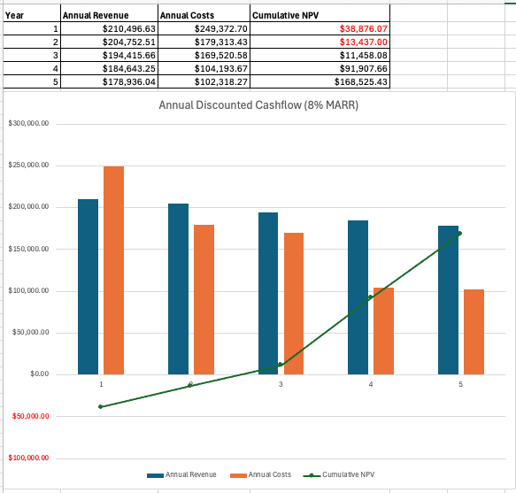
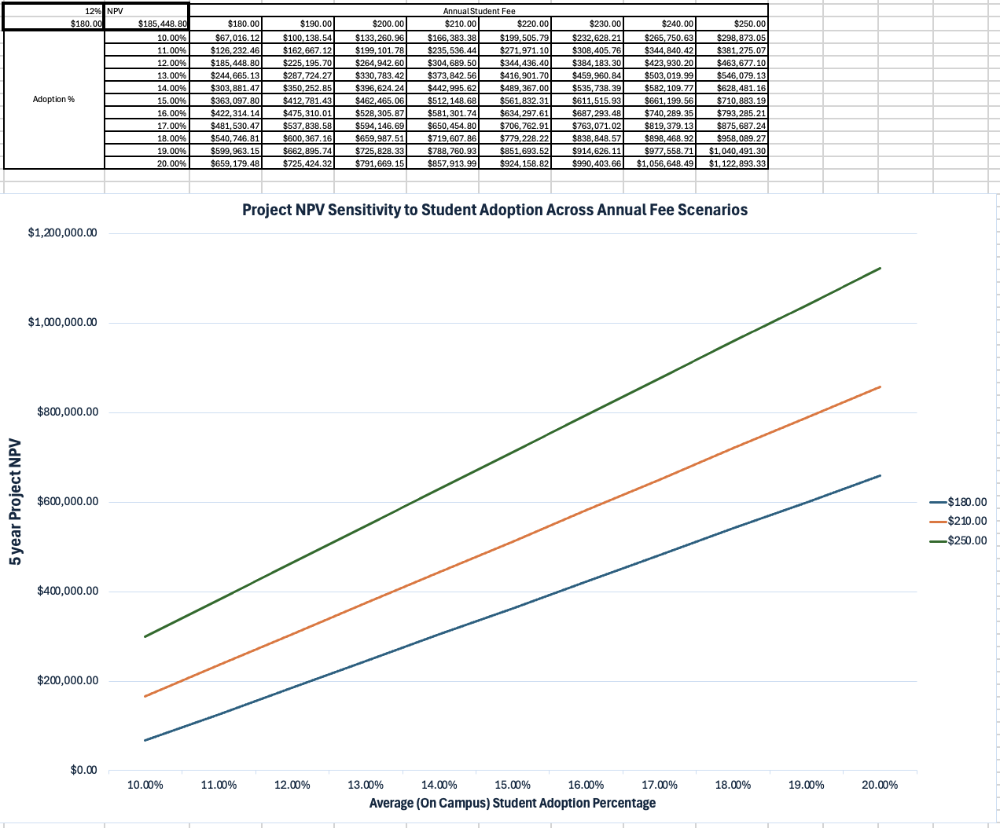

# CSUEB Electric Scooter Fleet Rollout

**Domain:** Systems Logistics | Financial Engineering | IoT Infrastructure | Regulatory Compliance  
**Tools & Frameworks:** Operations Research, Engineering Economics (NPV/AEC/MARR), Joyride IoT, Kuhmute Smart Hubs  
**Project Team:** Evan Warren, Harman Singh, Camari Randolph, and Andrew Ibrahim

> **Executive Impact:** Completed as a collaborative Industrial & Systems Engineering project with **Harman Singh**, **Camari Randolph**, and **Andrew Ibrahim**, this study models an end-to-end 130-vehicle electric scooter micro-mobility rollout at Cal State East Bay (2026–2031). Under a baseline 12% student adoption rate (864 opt-in users), the system achieves a verified **`$168,525.43` Net Present Value (NPV)** and **`$42,208.28` Annual Equivalent Worth (AEC)** at an 8% MARR. Revenue is driven by a hybrid pricing structure combining a **`$180.00` annual membership fee** with a **`$0.50/mile` monthly usage fee**, supported by a 60-month discounted cash flow schedule and a 2D sensitivity matrix validating positive returns from **`$52.9k` to `$1.09M` NPV**.  
>  
> **Note:** *Static charts and screenshots on a webpage cannot do this interconnected 10-sheet systems model justice—I highly encourage you to download and explore the actual Excel workbook below!*

### Project Resource & Full Workbook
* [📥 **Download Complete 10-Sheet Financial & Systems Excel Model (`INDE 460 - Cost Final Project.xlsx`)**](https://github.com/evanjameswarren/evanjameswarren.github.io/raw/main/Electic%20Scooter%20Fleet/INDE%20460%20-%20Cost%20Final%20Project.xlsx)

---

## 1. Visual Financial Analytics & Sensitivity Modeling

### 5-Year Annual Discounted Cash Flow & Cumulative NPV (8% MARR)
By discounting monthly inflows and outflows back to Present Value ($t=0$), the annual cash flow profile clearly illustrates project payback in **Year 3 (`+$11,458` cumulative NPV)** followed by rapid margin expansion in **Years 4 and 5 (`+$168,525.43` cumulative NPV)** once the 3-year equipment financing loan is paid off.

### 2D NPV Sensitivity Matrix & Fee Tier Comparison
The sensitivity model evaluates 5-year project Net Present Value across student adoption rates (10%–20%) and annual opt-in membership fee tiers (`$180–$250`), confirming positive economic returns across every operating scenario (`$52,913` to `$1,094,688`).

### Baseline Financial Performance Summary

| Financial Metric | Baseline Model Value | Description / Basis |
| :--- | :---: | :--- |
| **5-Year Project NPV** | **`$168,525.43`** | Baseline at `$180/yr` fee + `$0.50/mile` & 12% adoption (8% MARR) |
| **Annual Equivalent Worth (AEC)** | **`$42,208.28`** | Annualized net economic worth over 5-year lifecycle |
| **NPV Sensitivity Range** | **`$52,913 – $1,094,688`** | Evaluated across 10%–20% adoption & `$180–$250` annual fees |
| **Annual Opt-In Student Fee** | **`$180.00 / year`** | Generates `$155,520/yr` baseline from 864 subscribers (inflated annually) |
| **Per-Mile Usage Fee** | **`$0.50 / mile`** | Collected monthly (`~$5,193/mo`) across 124,629 annual fleet miles |
| **Active Fleet & Infrastructure** | **100 Active (30 Spares)** | 130 total NIU KQi 100P units, 5 Kuhmute smart hubs (100 ports) |
| **Monthly Operating Costs** | **`~$16,000 / month`** | Yr 1–3 with loan financing; drops to `~$9,500/mo` in Yr 4–5 |

---

## 2. Multidisciplinary Systems Engineering Scope

Rather than treating campus micro-mobility as a simple purchasing problem, our model integrates six distinct engineering and economic sub-disciplines into a single interconnected workbook:

| Systems Engineering Category | Key Variables & Factors Modeled in Workbook |
| :--- | :--- |
| **1. Financial Engineering & Economics** | 8% MARR discounting, 3.5% compounding annual inflation, 1/3/5-year loan annuity options (5%–7% interest, 25% down), 60-month cash flow schedule |
| **2. Market Adoption & Demand Pricing** | 12,000 student enrollment, 60% on-campus factor, 10%–20% adoption sensitivity, `$180/yr` opt-in fee + `$0.50/mile` usage pricing, 0.75-mi avg trip |
| **3. Fleet Reliability & Maintenance** | Component failure rates, 30-unit spare rotation fleet, 2-month parts inventory buffer (`$3,000` storage depot), `$100/hr` outsourced technician labor, freight & shipping costs |
| **4. Electrical & Site Infrastructure** | 5 Kuhmute smart hubs (20 ports/hub = 100 charging ports), 243Wh battery kWh grid load (`~$70/mo`), `$6,000` visual lane markers & physical safety barriers |
| **5. Software, IoT & User Interface** | Joyride Scale Plan (`$2,500/mo`), CSU student ID verification, IoT downhill speed governing (12 mph max), automated `<30%` low-battery return prompts |
| **6. Regulatory, Permitting & Safety** | Annual permits (`$2,500/yr`: CSU Building, Electrical, ADA path clearance, Fire Marshal, EHS, SMOP) and California Vehicle Code (CVC) compliance |

---

## 3. Detailed Subsystem Breakdown

### A. Financial Engineering & Economic Modeling
* **60-Month Discounted Cash Flow:** Evaluates monthly inflows and outflows against an 8% Minimum Acceptable Rate of Return (MARR) across 1-year, 3-year, and 5-year loan financing structures (selecting the optimal 3-year annuity at 6% nominal interest with 25% down payment).
* **Compounding Inflation:** Applies a 3.5% annual compounding inflation factor (`(1 + 0.035)^(t/12)`) across labor, replacement parts, electricity, permits, and software licensing.

### B. Revenue Architecture: Hybrid Fee Model
* **Annual Opt-In Membership (`$180.00/yr`):** Modeled on 12,000 enrolled students with 60% consistent on-campus presence (7,200 students). A conservative 12% adoption rate captures **864 opt-in subscribers**, generating **`$155,520`** in Year 1 upfront revenue.
* **Monthly Per-Mile Usage Fee (`$0.50/mile`):** Based on 864 daily trips averaging 0.75 miles across 195 active campus days/year (124,629 total fleet miles/year), contributing **`$5,192.88/month` (`$62,315/yr`)** in steady monthly cash flow.

### C. Fleet Reliability, Spare Parts & Shipping Logistics
* **Fleet Sizing & Utilization:** 100 active NIU KQi 100P scooters + 30 spare rotation scooters (**130 total units**). Active scooters average 5.4 miles/day out of an 18-mile range (30% daily battery capacity usage).
* **Parts Reliability & Freight:** Models individual component replacement rates, shipping/freight costs, a `$3,000` on-site storage unit holding a 2-month spare parts buffer, and outsourced maintenance labor at `$100/hr` (East Bay Motorsports).

### D. Infrastructure, IoT Geofencing & Regulatory Compliance
* **Kuhmute Smart Hubs & Site Prep:** 5 charging hubs (20 ports each = 100 active ports) with MLCS docking telemetry, plus `$6,000` for visual lane striping and physical barriers.
* **Joyride IoT & CVC Compliance:** Enforces 12 mph downhill speed limits via GIS geofencing, disables throttles outside campus borders, prompts charging returns below 30% battery, and satisfies ADA path clearance and multi-agency CSU/city permitting.

---

[← Back to Main Portfolio](../index.html)
