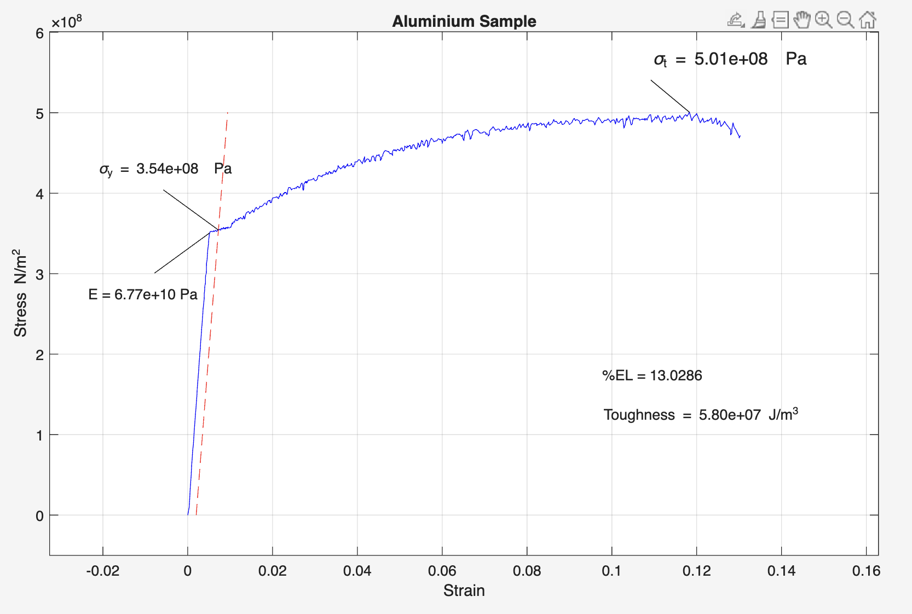

# Automated Material Stress-Strain Curve Analyzer

**Domain:** Materials Science & Engineering | Experimental Data Processing | Numerical Integration  
**Tools & Frameworks:** MATLAB, Universal Tensile Testing Machine Data (`.csv`), 0.2% Offset Yield Algorithm, Numerical Integration

> **Project Overview & Experimental Context:** Built a custom MATLAB analysis pipeline to process **real experimental tensile test data collected in the lab on a physical tension testing machine**. Raw load-displacement measurements from an aluminum cylindrical specimen ($d = 3.33\text{ mm}$, $L_0 = 35\text{ mm}$) are automatically scrubbed of initial fixture slack and post-fracture drop-off, converted into engineering stress and strain, and analyzed to extract Young's Modulus ($E$), 0.2% Offset Yield Strength ($\sigma_y$), Ultimate Tensile Strength ($\sigma_t$), Percent Elongation ($\%\text{EL}$), and Material Toughness—complete with auto-scaled plot callouts.

### Project Source Files & Experimental Data
* [📥 Download `Lab5.m` (Main Stress-Strain Processing & Plotting Script)](https://github.com/evanjameswarren/evanjameswarren.github.io/raw/main/Stress%20Stain/Lab5.m)
* [📥 Download `toughness.m` (Custom Numerical Integration Function)](https://github.com/evanjameswarren/evanjameswarren.github.io/raw/main/Stress%20Stain/toughness.m)
* [📥 Download `Aluminium Sample.csv` (Raw Lab Tensile Machine Data)](https://github.com/evanjameswarren/evanjameswarren.github.io/raw/main/Stress%20Stain/Aluminium%20Sample.csv)

---

## 1. Automated Plot Output & Extracted Material Properties



### Extracted Mechanical Properties (Aluminum Lab Specimen)

| Material Property | Symbol | Extracted Value | Algorithmic Method |
| :--- | :---: | :---: | :--- |
| **Young's Modulus (Elasticity)** | $E$ | **`6.77e+10 Pa` (67.7 GPa)** | Mean linear slope ($\sigma / \epsilon$) across elastic region |
| **0.2% Offset Yield Strength** | $\sigma_y$ | **`3.54e+08 Pa` (354 MPa)** | Intersection of $0.002$ parallel offset line with experimental curve |
| **Ultimate Tensile Strength** | $\sigma_t$ | **`5.01e+08 Pa` (501 MPa)** | Global maximum stress prior to necking and fracture |
| **Material Toughness** | $U_T$ | **`5.80e+07 J/m³`** | Trapezoidal numerical integration under the stress-strain curve |
| **Ductility (Percent Elongation)** | $\%\text{EL}$ | **`13.03%`** | Maximum plastic strain at specimen fracture ($\epsilon_{\text{max}} \times 100$) |

---

## 2. Algorithmic Pipeline & MATLAB Implementation

### A. Sensor Data Scrubbing & Fracture Detection
Raw data from a physical tension machine includes initial negative/zero slack before the grips seat and a sharp vertical drop when the specimen snaps. The script automatically detects the exact fracture index using the maximum first-difference spike (`max(abs(diff(stress)))`) and cleans the vectors:

```matlab
avgDiameter = 3.33*10^(-3);
area = pi*.25*(avgDiameter)^2; % Cross-sectional area in m^2
avgLength = 35*10^(-3);        % Gauge length under tension (m)
stress = table2array(rawSampleData(:,2))/area;
strain = table2array(rawSampleData(:,1))/avgLength;

% Scrubbing post-fracture drop and negative initial slack
[~,breakPoint] = max(abs(diff(stress))); % Detecting exact fracture point
stress(breakPoint:end) = [];
strain(breakPoint:end) = [];
negativeStrain = find(strain<=0);
stress(negativeStrain) = [];
strain(negativeStrain) = [];
strain = [0;strain]; % Zeroing origin
stress = [0;stress];
```

### B. Programmatic 0.2% Offset Yield Strength Intersection
Rather than reading yield strength by eye, the script constructs the `0.002` strain-offset line using the calculated Young's Modulus ($E$) and locates the exact array index where the difference between the experimental curve and the offset line crosses zero:

```matlab
% Constructing 0.2% (0.002) offset line
offsetY = linspace(0,tensileStrength,length(stress));
offsetX = offsetY./modulus + .002;
plot(offsetX,offsetY,"--r")

% Finding exact intersection index for Yield Strength
offsetIndex = find(strain >= .002);
offsetArray = modulus*(strain(offsetIndex) - strain(offsetIndex(1)));
error = stress(offsetIndex) - offsetArray;
negativeError = find(error < 0);
yieldStrengthIndex = negativeError(1) - 1 + offsetIndex(1);
yieldStrain = strain(yieldStrengthIndex);
yieldStrength = stress(yieldStrengthIndex);
```

### C. Custom Numerical Integration for Material Toughness (`toughness.m`)
To compute the total energy absorbed per unit volume prior to fracture ($\int_0^{\epsilon_f} \sigma \, d\epsilon$), a custom integration function sums the rectangular base (`h*dw`) and triangular top (`0.5*dw*dh`) across every discrete sensor step:

```matlab
function area = toughness(stress,strain)
area = 0;
for i = 2:length(stress)
    h = stress(i);
    dw = strain(i) - strain(i-1);
    dh = stress(i) - stress(i-1);
    area = area + h*dw + .5*dw*dh;
end
end
```

---

[← Back to Main Portfolio](../index.html)
