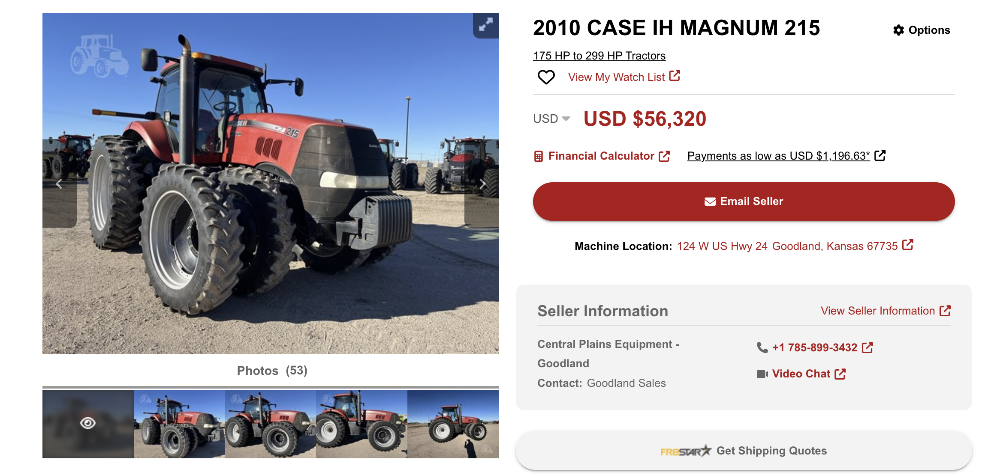
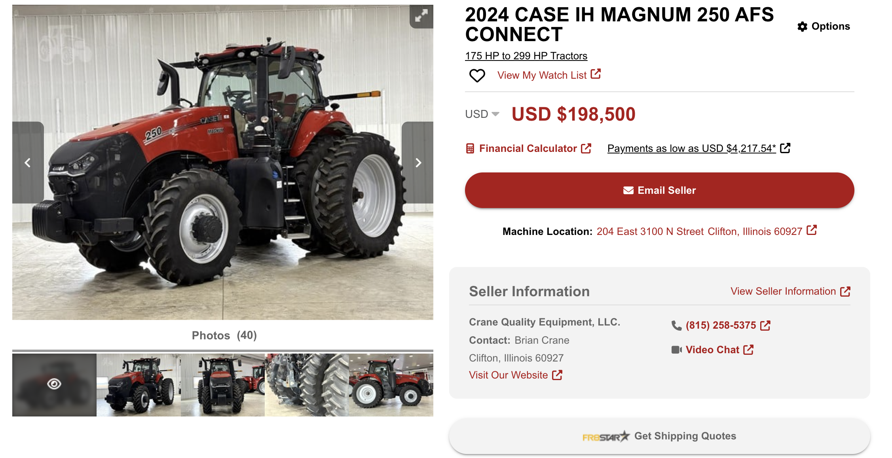

# Tractor Lifecycle Economic Replacement Analysis

**Domain:** Engineering Economics | Lifecycle Costing | MACRS After-Tax Cash Flow | Replacement Analysis  
**Tools & Frameworks:** Excel Proforma Modeling, Capital Recovery (CR), Annual Equivalent Cost (AEC), 7-Year MACRS Depreciation, Sensitivity Analysis  
**Project Team (Group 8):** Evan Warren, Idrissa Dembele, and Pili Fonua

> **Project Overview & Team Attribution:** Completed as a collaborative Engineering Economics group project with **Idrissa Dembele** and **Pili Fonua**, this study evaluates a real-world agricultural capital equipment replacement decision: purchasing a used **2010 Case IH Magnum 215 (`$56,320`)** with a recently rebuilt transmission versus a nearly new **2024 Case IH Magnum 250 AFS Connect (`$198,500`)**. Across a 10-year economic lifecycle at 600 operating hours/year (`15% MARR`, `40% Tax Rate`), the 2010 Magnum 215 outperforms the 2024 model by **`$21,621/year` in Annual Equivalent Cost (AEC)** (`-$36,123/yr` vs. `-$57,744/yr`).

### Project Source File
* [📥 Download Original Engineering Economics Model (`TractorComparison.xlsx`)](https://github.com/evanjameswarren/evanjameswarren.github.io/raw/main/Tractor%20Comparison/TractorComparison.xlsx)

---

## 1. Candidate Equipment & Market Quotes

### Challenger 1: 2010 Case IH Magnum 215 (`$56,320`)
* **Specifications:** 221 HP engine, 10,601 total chassis hours, **4,101 hours on overhauled transmission** (rebuilt at 6,500 hours), front & rear dual tires (40% tread).

### Challenger 2: 2024 Case IH Magnum 250 AFS Connect (`$198,500`)
* **Specifications:** 250 HP engine, 542 verified hours, factory guidance & modern cab telemetry, single front / dual rear tires.

---

## 2. Granular Annual Operating Cost (AOC) Breakdown

Assuming **600 operating hours/year** at a 70% average job load scale, annual operating expenses were modeled from agricultural extension data (Virginia Tech, Iowa State, and UNL Extension):

| Cost Component | 2010 Magnum 215 | 2024 Magnum 250 | Modeling Basis & Assumptions |
| :--- | :---: | :---: | :--- |
| **Diesel Fuel** | `$20,024.93` | `$17,650.94` | `$3.528/gal` (IA avg); `9.46 gal/hr` (+10% age wear penalty) vs. `8.34 gal/hr` (-10% modern efficiency bonus) |
| **Tire Replacement Wear** | `$2,057.14` | `$1,680.00` | 3,500-hr tire life (`17.14%` annual wear); 8-tire dual setup (`$12,000` set) vs. 6-tire setup (`$9,800` set) |
| **Routine Maintenance** | `$1,410.00` | `$1,112.00` | Scheduled oil (250 hr), fuel/air filters (500 hr), transmission (750 hr), and hydraulic (1,000 hr) intervals |
| **Unscheduled Repairs** | `$2,000.00` | `$500.00` | Accounts for 4,101 post-rebuild transmission hours on the 2010 unit vs. early-life reliability on the 2024 unit |
| **Insurance (`0.5%`)** | `$281.60` | `$992.50` | Scaled at 0.5% of initial purchase price |
| **Total Annual Operating Cost (AOC)** | **`$25,492.07`** | **`$20,942.94`** | Newer 2024 model saves **`$4,549.13/year`** in operating expenses |

---

## 3. Salvage Value Modeling & Capital Recovery (CR)

Because standard flat-percentage salvage rules fail to capture the difference between a machine on its **second rebuilt transmission** and a nearly new unit on its **first transmission**, our team developed two salvage depreciation models:

1. **Method 1 (Standard Resale Curve):** Applies an `8.3%` annual resale depreciation rate (with a `25%` Year-1 off-the-lot drop for the 2024 model).
2. **Method 2 (Custom Transmission-Hour Salvage Model):** Combines a `3%` baseline age decay with hourly transmission life consumption:
   * **2010 Magnum 215:** Enters with ~6,000 hours remaining on its rebuilt transmission toward a **`$12,000` scrap value floor** (reached at Year 8 at 600 hrs/yr).
   * **2024 Magnum 250:** Enters with ~10,000 hours on its original transmission (after a 25% Year-1 drop) toward a **`$40,000` first-transmission rebuild salvage floor**.

### 10-Year Constant-Dollar Economic Comparison (Method 2 @ 15% MARR)

| Economic Metric (Year 10) | 2010 Case IH Magnum 215 | 2024 Case IH Magnum 250 | Economic Advantage |
| :--- | :---: | :---: | :--- |
| **Annual Operating Cost (AOC)** | `-$25,492.07` | `-$20,942.94` | Magnum 250 by `+$4,549.13/yr` |
| **Capital Recovery Cost (CR)** | `-$10,630.85` | `-$36,800.81` | **Magnum 215 by `+$26,169.96/yr`** |
| **Total Annual Equivalent Cost (AEC)** | **`-$36,122.92`** | **`-$57,743.74`** | **2010 Magnum 215 Wins by `$21,620.82/yr`** |

---

## 4. After-Tax Cash Flow Proforma & Sensitivity Analysis

To validate the winning **2010 Case IH Magnum 215** on an after-tax basis, a 10-year proforma was constructed incorporating **7-Year MACRS tax depreciation shields** at a **40% corporate tax rate**:

* **After-Tax Net Present Value (NPV):** **`-$223,396.68`**
* **After-Tax Annual Equivalent Cost (AEC):** **`-$44,512.25 / year`**

### $\pm 30\%$ Parameter Sensitivity Analysis (After-Tax AEC)
Sensitivity testing across $\pm 30\%$ swings in key operational variables confirmed that the decision is most sensitive to **Annual Operating Hours** and **Diesel Fuel Price**, while remaining highly resilient to spikes in unscheduled repair costs:

| Sensitivity Variable | `-30%` Variation | Baseline (`0%`) | `+30%` Variation | Total AEC Swing Range |
| :--- | :---: | :---: | :---: | :---: |
| **Annual Operating Hours** | `-$36,266.06` | `-$44,512.25` | `-$52,758.44` | **`$16,492.38`** |
| **Diesel Fuel Price** | `-$37,330.23` | `-$44,512.25` | `-$51,694.26` | **`$14,364.03`** |
| **Unscheduled Repairs** | `-$43,794.94` | `-$44,512.25` | `-$45,229.56` | **`$1,434.61`** |

---

[← Back to Main Portfolio](../index.html)
